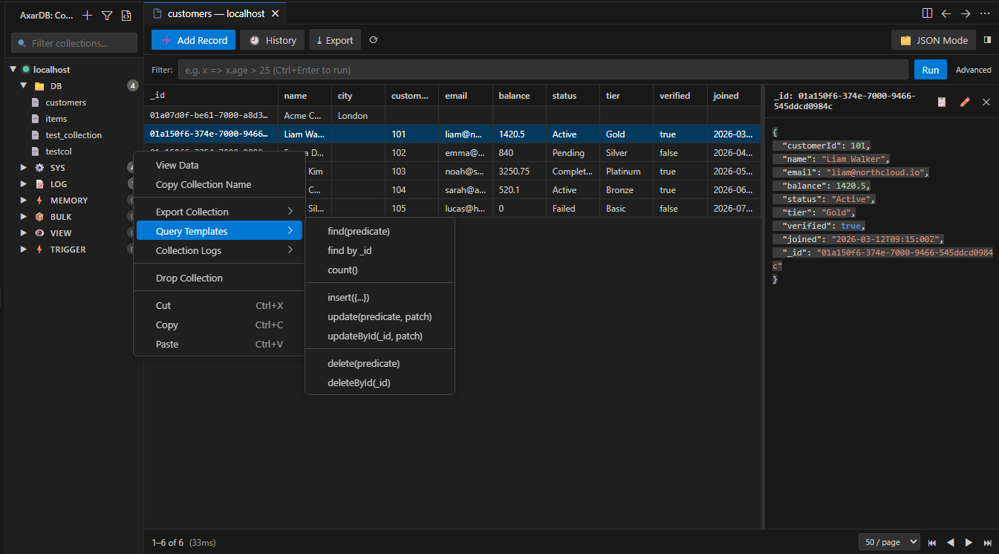

# AxarDB for Visual Studio Code

The official Visual Studio Code extension for **AxarDB** — a high-performance, embedded document database engine with native JavaScript query capabilities.



---

## ✨ Features

- **Multi-Server Management:**
  - Add, edit, remove, and connect to multiple AxarDB instances.
  - Secure credential storage using VS Code's native `SecretStorage`.
  - Color-coded badges and real-time connection status indicators.

- **7-Category Collection Tree with Live Search:**
  - Distinct accordions matching the database architecture:
    - **DB:** Primary editable collections (`col_*`).
    - **SYS:** System collections (`sysusers`, `sysqueue`, `sysvaults`, `sysconfig`).
    - **LOG:** System logs (`syslogs`).
    - **MEMORY:** Fast in-memory collections.
    - **BULK:** Large bulk dataset storage.
    - **VIEW:** Stored query views.
    - **TRIGGER:** Event-driven database triggers.
  - Instant substring search input with highlighted matches and matched/total counters.

- **Versatile Data View:**
  - **Editable DataGrid:** Tabular view with frozen `_id` column, cell editing on double click, and virtual scrolling.
  - **JSON Document Cards:** Card-based JSON document list.
  - **Resizable Side Panel:** Inspect selected documents with pretty syntax-highlighted JSON, inline editor, and copy utilities.

- **Query Execution & Playground:**
  - Open untitled `.axar.js` files with integrated `▶ Run AxarDB Query` CodeLens.
  - Run queries using `Ctrl+Enter`.
  - Ring-buffered Query History with search, execution time tracking, and pinning.

- **Export & Backup:**
  - Export collections or query results to **JSON**, **JSONL**, or **CSV** (RFC 4180 compliant with nested object dot-notation flattening).

- **Native Context Menus:**
  - Right-click servers, categories, collections, and rows for contextual actions (templates, exports, logs, copy `_id`, duplicate, generate update/delete queries).

---

## ⚡ Query Language: AxarDB JavaScript Arrow Functions

> ⚠️ **Note:** AxarDB does **NOT** use MongoDB or SQL syntax. Queries are written as JavaScript arrow function predicates against collection bridges.

### Examples

```javascript
// Find active users older than 25
db.users.findall(x => x.active == true && x.age > 25).take(50);

// Order by date descending with pagination
db.orders.findall(x => x.total >= 100)
  .orderByDesc(x => x.createdAt)
  .skip(0)
  .take(20);

// Find single document by _id
db.users.find(x => x._id == "user_123");

// Count documents
db.users.count();

// Insert new document
db.users.insert({
  name: "John Doe",
  email: "john@example.com",
  role: "developer"
});

// Update documents by predicate
db.users.update(x => x._id == "user_123", {
  role: "admin"
});

// Delete document by _id
db.users.delete(x => x._id == "user_123");
```

---

## ⌨️ Keyboard Shortcuts

| Shortcut | Description |
|:--|:--|
| `Ctrl+Enter` / `Cmd+Enter` | Run current query in query editor or query bar |
| `Ctrl+F` (in Connections view) | Focus collection filter input |
| `Esc` (in filter input) | Clear filter and restore all tree categories |
| `Enter` (on tree collection) | Open collection in Data Panel |

---

## ⚙️ Extension Settings

| Setting | Default | Description |
|:--|:--|:--|
| `axardb.dataView.defaultMode` | `"grid"` | Default view mode (`"grid"` or `"json"`) |
| `axardb.dataView.pageSize` | `50` | Default number of records per page |
| `axardb.query.timeoutMs` | `30000` | HTTP query timeout in milliseconds |
| `axardb.history.maxItems` | `200` | Maximum queries stored in history ring buffer |
| `axardb.confirmDestructive` | `true` | Ask confirmation before drop or delete operations |

---

## 📦 Building and Testing

```bash
# Install dependencies
npm install

# Run Vitest unit & integration tests
npm test

# Type check
npm run typecheck

# Build extension and webview bundles
npm run build
```

---

## 📄 License

MIT
